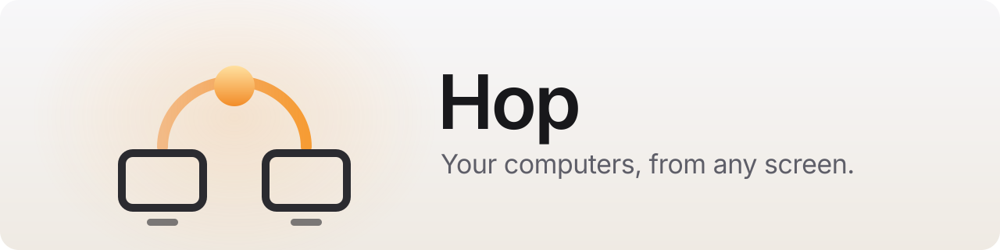
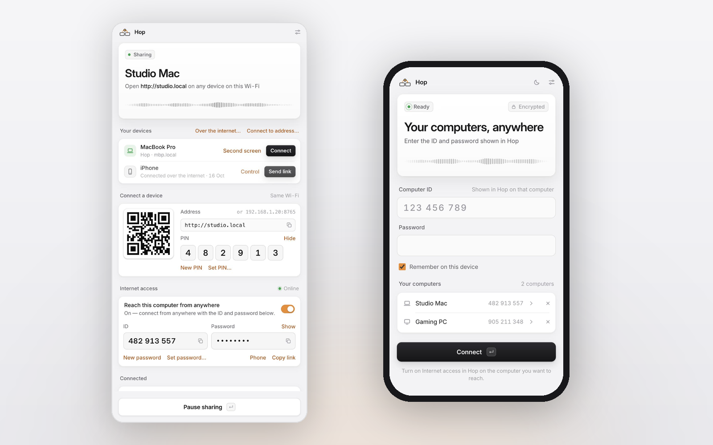
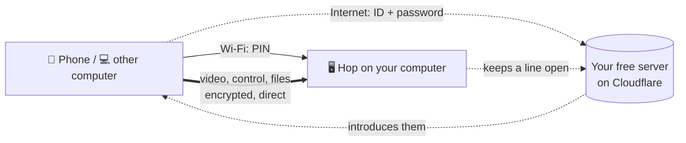

<p align="center">
  <picture>
    <source media="(prefers-color-scheme: dark)" srcset="docs/images/banner-dark.svg">
    
  </picture>
</p>

<p align="center">
  <a href="https://github.com/Nikita-Shulga/Hop/releases/latest"></a>
  <a href="https://github.com/Nikita-Shulga/Hop/releases"></a>
  <a href="https://github.com/Nikita-Shulga/Hop/actions/workflows/build.yml"></a>
  
  <a href="LICENSE"></a>
</p>

<p align="center">
  <b><a href="https://github.com/Nikita-Shulga/Hop/releases/latest">Download</a></b> ·
  <a href="#how-it-works">How it works</a> ·
  <a href="#faq">FAQ</a> ·
  <a href="docs/GUIDE.md">Guide</a> ·
  <a href="CHANGELOG.md">Changelog</a>
</p>

---

**Hop lets you see and control your Mac or PC from your phone, tablet or another computer** — at home on your Wi-Fi, or from anywhere. No account, no subscription, nothing to install on the phone.

<p align="center">
  <picture>
    <source media="(prefers-color-scheme: dark)" srcset="docs/images/hero-dark.png">
    
  </picture>
</p>

## Features

|  |  |
| --- | --- |
| 🖥️ **See and control** | Live screen, mouse, keyboard, scrolling. Ctrl and Cmd swap automatically between Mac and PC. |
| 📱 **Great on iPhone** | Trackpad or touch mode, pinch to zoom, rotate, a keyboard with Esc, Tab and arrows, shortcuts. Add it to the Home Screen and it opens like an app. |
| 🌍 **From anywhere** | Real video over the internet, encrypted end to end, through your own free server. New devices are confirmed with a code on the computer. |
| 🖥️➕ **Second screen** | Turn a PC, Mac or iPad into an extra display for your Mac. |
| 🔗 **One click** | Your computers find each other on the Wi-Fi. Press **Connect** — in a window, full screen or a browser tab. |
| 📋 **Clipboard & files** | Send text and files both ways, on Wi-Fi and over the internet. |
| 🔄 **One-click updates** | Hop checks GitHub and updates itself; your settings stay. |
| 🔒 **Private** | PIN on Wi-Fi, password + device pairing over the internet. No telemetry. |

## Download

| System | Package |
| --- | --- |
| **Windows 10 / 11** | `Hop-<version>-win-x64.zip` |
| **macOS 11+**, Apple silicon | `Hop-<version>-mac-arm64.zip` |
| **macOS 11+**, Intel | `Hop-<version>-mac-x64.zip` |

Get them from the **[latest release](https://github.com/Nikita-Shulga/Hop/releases/latest)**. Every build is started and signed in to automatically before it's published.

**Windows:** extract the whole ZIP, run `Hop.exe`, and allow it on **Private networks**. SmartScreen may warn the first time: **More info → Run anyway**.
**macOS:** move **Hop.app** to Applications, right-click → **Open** the first time, then click the two **Allow** buttons Hop shows.

## Quick start

1. **Open Hop** on each computer you want to reach.
2. **At home:** scan the QR code in the Hop window with your phone (or open `mac.local` / `pc.local`) and enter the PIN.
3. **From anywhere** *(optional)*: switch on **Internet access** and follow its two steps, then tap **Phone** and scan once.

Your other computers appear under **Your devices** — **Connect** or **Second screen** is one click.

## How it works



- **On Wi-Fi**, your phone talks straight to the computer. Nothing leaves your network.
- **Over the internet**, your own server only introduces the two devices. Video, control, files and the password go **directly between them**, encrypted. The server is private: without its secret key it shows *Not found*.
- **Setting up the server** takes about 3 minutes and is free — Hop walks you through it, or use [one click on Cloudflare](cloud/README.md).

## FAQ

<details>
<summary><b>Is it safe?</b></summary>

On Wi-Fi, every connection needs the PIN. Over the internet, a device needs the computer's 9-digit ID **and** its password, and the first time it must be confirmed by typing a code **on the computer** — so a stolen password alone isn't enough. Wrong passwords lock the sender out, and guessing from many addresses pauses sign-ins. You can also turn on **Ask before someone connects**.
</details>

<details>
<summary><b>Do I need a server? Does it cost anything?</b></summary>

Only for internet access. It runs on Cloudflare's free plan and Hop sets it up with you. Your other computers pick it up automatically.
</details>

<details>
<summary><b>Can I control my iPhone?</b></summary>

Apple doesn't allow that for any app. Hop's **Control** button opens Apple's own iPhone Mirroring on your Mac (macOS 15+). Your iPhone *can* control your computers with Hop.
</details>

<details>
<summary><b>Second screen on Windows?</b></summary>

A Mac can be extended by Hop directly. Windows only adds displays through a driver: install a virtual display driver (or an HDMI dummy plug), then pick that display in Hop. Details in the [guide](docs/GUIDE.md#second-screen).
</details>

<details>
<summary><b>Why does my computer warn about an unknown developer?</b></summary>

Hop isn't notarized by Apple or code-signed for Windows yet. Each release lists `SHA256SUMS.txt` so you can verify the downloads, or [build it yourself](#build-from-source).
</details>

<details>
<summary><b>How do updates work?</b></summary>

Hop checks this repository's latest release at start and every 6 hours. **Update now** downloads your platform's ZIP, verifies its checksum, swaps the app and reopens it. Settings stay.
</details>

## Build from source

You need Python 3.10+ (and Node.js only for the server).

```sh
git clone https://github.com/Nikita-Shulga/Hop.git && cd Hop
./start-mac.command            # run from source on a Mac  (start-windows.bat on Windows)
packaging/build-mac.sh         # build Hop.app            (packaging\build-windows.bat → Hop.exe)
```

Pushing a tag like `v2.0.0` builds, tests and publishes all three downloads with GitHub Actions. How the pieces talk is in [PROTOCOL.md](PROTOCOL.md).

## License

[MIT](LICENSE) © 2026 Nikita Shulga. Inter typeface under the SIL Open Font License.
